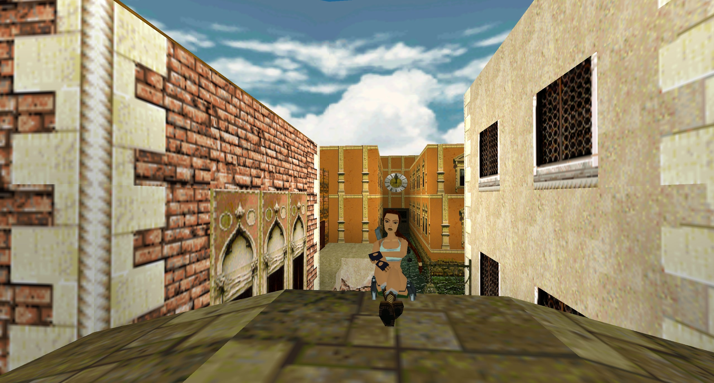
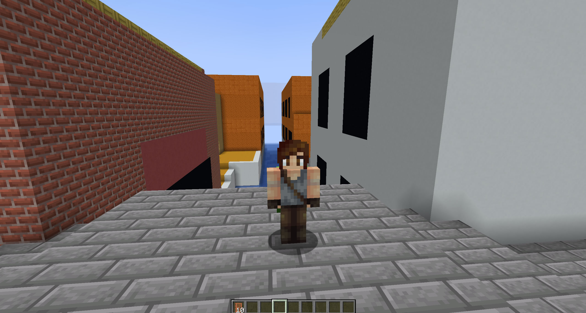

## Minecraft Raider

A tool for converting Tomb Raider's OBJ rooms geometry to schematics for Minecraft

## Extracting Rooms from a Tomb Raider level

First of all make sure to have Tomb Editor and the prj file of the level, once opened, go to the 2D editor, press CTRL+A, right click on any room and click on Export Rooms

## Usage

Download the app from the releases or run it manually by following the steps below

First of all run `pip3 install -r requirements.txt`

Run `python3 main.py` 

Once ran the app you'll need to select the obj, and after that, you'll find the texture assegnation window. 

Remember that the numbers are ordered by texture, e.g. 0,1; the left number is the vertical and the right one the orizontal

```
(0,1) = right of (0,0)
(1,0) = below (0,0)
```


